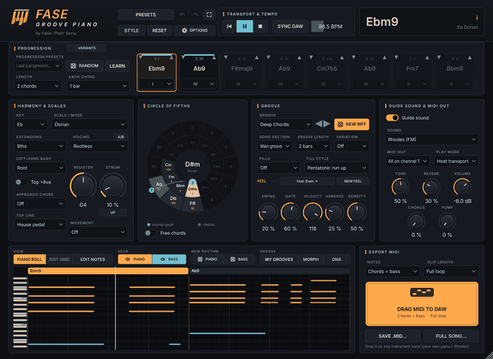
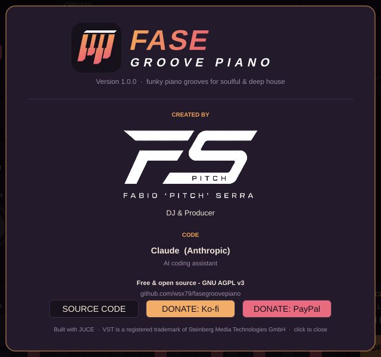

<p align="center"></p>

<p align="center">
  <b>Funky piano grooves for soulful, deep &amp; jackin' house, ready to drag into your DAW.</b><br>
  by <b>Fabio 'Pitch' Serra</b> · VST3 / AU · Windows &amp; macOS · free and open source
</p>

<p align="center"><b>🇬🇧 English</b> · <a href="README.it.md">🇮🇹 Italiano</a></p>

<p align="center">
  <a href="docs/GUIDE.md"><b>📖 User guide</b></a> ·
  <a href="CHANGELOG.md">🆕 What's new</a> ·
  <a href="#download">⬇️ Download</a> ·
  <a href="#support-the-project">☕ Support the project</a> ·
  <a href="#credits">Credits</a> ·
  <a href="PRIVACY.md">Privacy</a> ·
  <a href="#license">License</a>
</p>

---

**Fase Groove Piano** is a VST3/AU instrument that **writes MIDI** piano parts: pick a key, a
scale and a progression and you get extended chords (9ths, 11ths, 13ths), keyboard-player
voicings, syncopated grooves with swing, a left-hand bass and pentatonic fills. Listen with the
guide sound, then **drag it into your DAW as a MIDI clip** and play it with your own piano,
Rhodes or synth.



🌐 **Website:** [wsx79.github.io/fasegroovepiano](https://wsx79.github.io/fasegroovepiano/)

## Features

- ✨ **Version 2.0: a new interface**, clean and professional: graphite studio look, icon buttons, a real transport (▶ ❚❚ ■), clear switches to hear the piano or the bass.
- 🎹 **Harmony:** 12 keys × 13 scales/modes (Major, Dorian, Minor, Mixolydian, Lydian, Phrygian,
  Locrian, Harmonic and Melodic Minor, Harmonic Major, Lydian Dominant, Mixolydian b6, Phrygian
  Dominant). Triads, 7ths, 9ths, 11ths/13ths, **6/9**, **add9**, **9sus4** and the gospel
  **altered V 13(b9)**, lush **m11 / maj9#11**, soulful **13ths** and funky **7#9**; clashing tensions are handled automatically.
- 🎛️ **Voicings:** Close, Drop 2, Drop 2+4, Rootless, Shell, Wide (two hands), Quartal, Octave triads (disco), Upper triad (house stab), Spread 10ths, Open 5ths (deep pad), with
  automatic voice leading.
- ↗️ **Approach chords:** the gospel half-step slide into every chord change (from above or below).
- 🔁 **Progressions:** 1–8 chords, 94 presets in a menu grouped by style (including circle-of-fifths and chromatic, borrowed-chord progressions) and
  **DICE** for random but musical progressions.
- ⭕ Interactive **circle of fifths**: the chords of the scale with their numerals, your progression as numbered dots joined by soft curves, drag the dots to change chords (even outside the scale).
- 🌈 **Harmony colours:** chords and chord changes coloured by how well they sound together (green = great, grey = clashes).
- 🎚️ **STYLE:** one-click setups by genre (deep, soulful, gospel, jackin', '90s piano, garage, afro, neo soul…) and **RESET** to start over.
- 🥁 **172 two-hand grooves** in 13 genres (**piano house** loops, soulful, deep, gospel, **jackin' house**, **jackin' piano**, garage, afro, funky & disco, '90s piano house, neo soul, chill, dance stabs), played in the classic house piano style: one shared top note (**House pedal**), the bass under every stab
  plus **NEW RIFF**, a random funky riff generator, and optional fills (11 styles, from gospel runs to piano glissandos).
- 🎚️ **Strum** (rolled chords like a real pianist) and **Top +8va** (bright octave-doubled top note).
- 🎼 **Piano roll** of every note that plays (chords, bass, fills) with the chord names and the playhead, which opens big to **edit the notes one by one** (zoom, velocity lane), and **BOTH / PIANO / BASS** to choose what you hear.
- ✏️ **Editable rhythm grid** split into parts **A/B/C/D** you can reorder, randomize (RND) and
  lock (LOCK).
- 🔍 **Resizable UI** and a mini window while you drag a clip.
- 🌍 **Interface in 6 languages:** English, Italiano, Español, Français, Deutsch, Português
  (**OPTIONS → SETTINGS**).
- 🎬 **Song sections:** Intro, Main, Break, Build-up, Drop, Outro (automatable), plus a **song window** (timeline of the sections, own variation and fill per section) to drag or save the **whole song** with markers, or one `.mid` per section.
- ⏱️ **Tempo:** synced to the DAW or set by hand.
- 📤 **MIDI:** drag the clip into your DAW (full, chords only, bass only), save it as `.mid`, or
  use live MIDI out (bass on its own channel if you like).
- 🔊 **Guide sounds:** Rhodes, Soulful Grand, House Piano (M1 style), House Organ, Wurlitzer,
  Gospel Organ (Leslie) and Warm Pad, with chorus and a sidechain-style **pump**, plus
  **PREVIEW** to hear the riff with the DAW stopped.
- 🎵 **Top line** (the melody of the top notes: smooth, steady, rising, falling, arch) and
  **▲▼ inversions** on every chord.
- 🎹 **LEARN:** play chords on your MIDI keyboard and they become the progression.
- 🎛️ **Chord Variation Lab:** more soulful, gospel, deep or chromatic versions of your progression, A/B while it plays.
- 🧬 **Musical DNA:** one click = one step more soulful, funkier, more minimal, more energetic or more sophisticated.
- 🔀 **Groove morph** from your groove to another one, and a **song arrangement** with a new variation per section and one .mid per section.
- 🆎 **Voicing Coach:** compare two voicings of your progression (range, voice movement, top line) and switch between them while it plays.
- 🎸 **Bass line library:** disco, funky, house and soulful lines with approach notes and dead notes, following your chords.
- 🔎 **MIDI analyzer:** drop a .mid file and it estimates key, chords and chord length, then loads them as the progression.
- 🔄 **Variations** every 4 or 8 bars, grooves of 1, 2 or 4 bars, **walking** and
  **syncopated-octave** bass, and an automatic crescendo in the build-up.
- 💾 **Your own presets**, **undo / redo** (Ctrl+Z) and **save all parts** (loop and whole song,
  full / chords / bass) to a folder in one click.

Everything is explained in the **[user guide](docs/GUIDE.md)**.

## Download

Ready-to-use builds are on the **[Releases](https://github.com/wsx79/fasegroovepiano/releases/latest)**
page. Development builds are under **[Actions](https://github.com/wsx79/fasegroovepiano/actions) → Build → Artifacts**.

| System | Package | Contents |
|---|---|---|
| **Windows 10/11 (64-bit)** | **`FaseGroovePiano-Windows-Setup.exe`** | **Installer: choose VST3, Standalone or both** |
| Windows 10/11 (64-bit) | `FaseGroovePiano-Windows.zip` | VST3 + Standalone (manual install) |
| macOS 10.13+ (Intel & Apple Silicon) | `FaseGroovePiano-macOS.zip` | VST3 + AU + Standalone |
| Linux | `FaseGroovePiano-Linux.zip` | VST3 + Standalone |

To install, follow the [guide](docs/GUIDE.md#1-installation).

## Support the project

Fase Groove Piano is **free**. If you find it useful and want to support its development, you can
make a donation of any amount:

<p align="center">
  <a href="https://ko-fi.com/fabios1979"><b>☕ Ko-fi – ko-fi.com/fabios1979</b></a> ·
  <a href="https://paypal.me/fabios79"><b>💙 PayPal – paypal.me/fabios79</b></a>
</p>

The same links are in the plug-in: **OPTIONS → ABOUT → DONATE: Ko-fi / DONATE: PayPal**.

Thank you! A star ⭐ on the repository or a share helps a lot too.

### Listen to my music

- 🎧 **Listen to my productions on Spotify:** [Fabio 'Pitch' Serra on Spotify](https://open.spotify.com/artist/29iQGuXML8LEw3xRp1dNRP)
- 🛒 **Download my tracks** from all the major digital music stores: search for **Fabio 'Pitch' Serra**.

## Credits

<p align="center"></p>

| | |
|---|---|
| **Idea, music direction and sound** | **Fabio 'Pitch' Serra** – DJ & Producer |
| **Code** | **Claude** (Anthropic) – AI coding assistant |
| **Framework** | [JUCE](https://juce.com) |

In the plug-in, open the credits with **OPTIONS → ABOUT** (or click the logo at the top left).
The **SPOTIFY** button there takes you to my artist page.

## Privacy

The plug-in **collects no data**. Its only internet connection is the optional update check on
GitHub (switch it off in OPTIONS → SETTINGS). Everything else stays on your computer. See the [privacy policy](PRIVACY.md).

## License

Fase Groove Piano is **free software**: you can use, study, modify and redistribute it under the
terms of the **GNU Affero General Public License v3.0 or later** ([LICENSE](LICENSE)).

In short:

- you can use it **for free**, including for commercial music: the license covers the code, not
  the songs you make. The MIDI and the music you create are **yours**;
- if you distribute a modified version, you must publish its source code under the same license;
- the software is provided **"as is", without warranty**.

The name **Fase Groove Piano**, the app logo and the **FS PITCH** logo belong to
Fabio 'Pitch' Serra and are not covered by the code license. If you publish a modified version,
please use a different name and logo.

Third-party components (JUCE, VST 3 SDK) and trademarks: see
[THIRD_PARTY_NOTICES.md](THIRD_PARTY_NOTICES.md).
*VST is a registered trademark of Steinberg Media Technologies GmbH.*

---

## For developers

### Building from source

You need CMake ≥ 3.22 and a C++17 compiler (Visual Studio 2022 on Windows, Xcode on macOS).
JUCE 8 is downloaded automatically.

```bash
cmake -B build -DCMAKE_BUILD_TYPE=Release
cmake --build build --config Release --parallel
ctest --test-dir build -C Release        # engine tests + plug-in tests
```

The built plug-ins are in `build/FaseGroovePiano_artefacts/Release/`.

### Website

The project page is `docs/index.html` (English/Italian). To publish it: repository
**Settings → Pages → Build and deployment → Deploy from a branch → `main` / `/docs` → Save**.
It appears at `https://wsx79.github.io/fasegroovepiano/`.

### macOS signing and notarization

Without extra setup the macOS build is signed ad hoc (users run `xattr -cr` once). With an
Apple Developer account, add these **repository secrets** (Settings → Secrets and variables →
Actions) and every release is signed with your Developer ID, notarized and stapled:
`MACOS_CERTIFICATE` (base64 of the *Developer ID Application* `.p12`),
`MACOS_CERTIFICATE_PASSWORD`, `MACOS_SIGN_IDENTITY` (e.g. `Developer ID Application: Name (TEAMID)`),
`APPLE_ID`, `APPLE_APP_PASSWORD` (an app-specific password) and `APPLE_TEAM_ID`.
To use a local copy of JUCE: `-DJUCE_DIR=/path/to/JUCE`.

On Linux you also need: `libasound2-dev libx11-dev libxrandr-dev libxinerama-dev libxcursor-dev
libxext-dev libfreetype-dev libfontconfig1-dev libxcomposite-dev`.

### Publishing a release

1. Add the new version at the top of [CHANGELOG.md](CHANGELOG.md) (English, used for the release
   text) and [CHANGELOG.it.md](CHANGELOG.it.md) (e.g. `## [1.2.0] - date`), and update `VERSION`
   in `CMakeLists.txt`, the guides (EN/IT) and the READMEs (EN/IT).
2. On GitHub open **Actions → Build → Run workflow**, enter the version in *release_tag*
   (e.g. `v1.2.0`) and run it. GitHub builds Windows, macOS and Linux and publishes a Release with
   the three zips; the release text is taken from the English changelog section.

Instead of step 2 you can also push a tag:

```bash
git tag v1.2.0 && git push origin v1.2.0
```

To fix the text of an existing release without rebuilding:
**Actions → Update release notes → Run workflow** with the tag (e.g. `v1.1.0`).

### Code layout

```
Source/engine/Theory.*        scales, diatonic chords, chord names, voicings and voice leading (pure C++)
Source/engine/GrooveEngine.*  rhythm patterns, progressions, swing/humanize, fills -> note events
Source/engine/Generators.*    random riffs, random progressions, song sections, arrangement, A/B/C/D parts
Source/GuideVoice.h           guide sounds: Rhodes, Soulful Grand, House Piano, House Organ
Source/PluginProcessor.*      parameters, tempo sync, MIDI in/out, clip export, user pattern
Source/PluginEditor.*         user interface and credits page
Source/CircleOfFifths.*       interactive circle of fifths
Source/Branding.*             logo, name, links
Resources/                    app logo (SVG), icon, FS PITCH logo
installer/windows/            Windows installer (Inno Setup script, icon, wizard images, texts)
tests/EngineTests.cpp         engine tests (no JUCE dependency)
tests/PluginTests.cpp         plug-in tests: state/presets, MIDI export, DAW transport, update swap
```

To add a groove, add a line to `groovePatterns()` in `GrooveEngine.cpp`: each character is a
16th note: `X` accent, `x` hit, `g` ghost note, `>` push (plays the next chord early),
`=` hold, `.` rest.

Donation and source-code links live in `Source/Branding.h` (`kofiUrl`, `paypalUrl`, `sourceUrl`);
an empty link hides its button.
