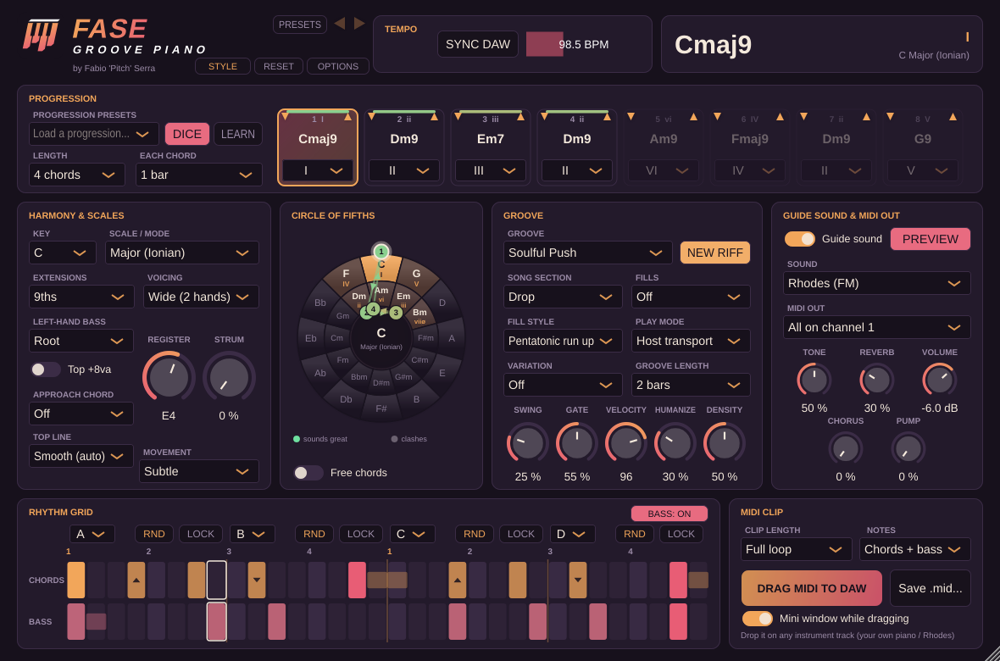
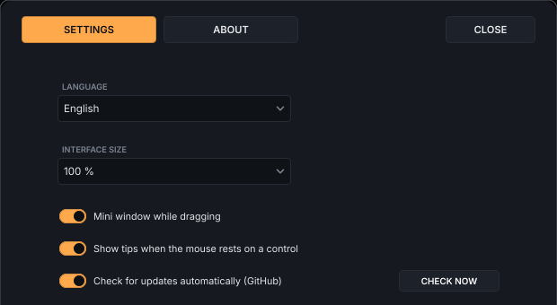

# Guida di utilizzo – Fase Groove Piano

*🇬🇧 [English version](GUIDE.md)*

<p align="center"></p>

Fase Groove Piano **crea MIDI** di giri di piano funky per soulful e deep house: scegli tonalità,
accordi e groove, ascolti il riff col suono guida e poi **trascini la clip MIDI nella DAW** per
suonarla col tuo piano, Rhodes o synth preferito.

**Indice**

1. [Installazione](#1-installazione)
2. [Primo giro in 60 secondi](#2-primo-giro-in-60-secondi)
3. [L'interfaccia, sezione per sezione](#3-linterfaccia-sezione-per-sezione)
4. [Esportare il MIDI nella DAW](#4-esportare-il-midi-nella-daw)
5. [Usare il MIDI in tempo reale](#5-usare-il-midi-in-tempo-reale)
6. [Costruire un brano: intro, break, drop](#6-costruire-un-brano-intro-break-drop)
7. [Ricette soulful e jackin' house](#7-ricette-soulful-house)
8. [Domande frequenti e problemi](#8-domande-frequenti-e-problemi)
9. [Ascolta la mia musica](#9-ascolta-la-mia-musica)

---

## 1. Installazione

### Windows: l'installer (il modo più semplice)

1. Scarica **`FaseGroovePiano-Windows-Setup.exe`** dall'
   [ultima release](https://github.com/wsx79/fasegroovepiano/releases/latest).
2. Avvialo. Se Windows mostra *"PC protetto da Windows"*, clicca **Ulteriori informazioni →
   Esegui comunque** (l'installer è gratuito e open source ma non è firmato con un certificato a
   pagamento).
3. Scegli cosa installare:
   - **Plugin VST3 + app Standalone** (consigliato)
   - **Solo plugin VST3** (per la tua DAW)
   - **Solo app Standalone** (senza DAW)
   - oppure una selezione personalizzata.
4. Fatto: il VST3 va in `C:\Program Files\Common Files\VST3`, l'app compare nel menu Start (e sul
   desktop, se spunti l'opzione). Rifai la scansione dei plugin nella DAW.

Per disinstallare: **Impostazioni → App → Fase Groove Piano → Disinstalla**.

### Installazione manuale (zip, tutti i sistemi)

Scarica lo zip del tuo sistema (vedi il [README](../README.it.md#download)) ed estrailo.

| Sistema | File | Dove copiarlo |
|---|---|---|
| Windows | `Fase Groove Piano.vst3` | `C:\Program Files\Common Files\VST3\` |
| macOS | `Fase Groove Piano.vst3` | `~/Library/Audio/Plug-Ins/VST3/` |
| macOS (Logic, GarageBand) | `Fase Groove Piano.component` | `~/Library/Audio/Plug-Ins/Components/` |
| Tutti | `Fase Groove Piano` (Standalone) | dove vuoi: è un'app che funziona anche senza DAW |

Riapri la DAW e fai una nuova scansione dei plugin se non lo trova da sola.
Il plugin è uno **strumento** (instrument): caricalo su una traccia MIDI/strumento, non come effetto.

**macOS – "il plugin è danneggiato / non verificato":** il plugin non è firmato con un certificato
Apple a pagamento. Apri il Terminale e lancia:

```
xattr -cr ~/Library/Audio/Plug-Ins/VST3/"Fase Groove Piano.vst3"
xattr -cr ~/Library/Audio/Plug-Ins/Components/"Fase Groove Piano.component"
```

---

## 2. Primo giro in 60 secondi

1. Carica **Fase Groove Piano** su una traccia strumento.
2. In **PROGRESSION** apri *Load a progression…* e scegli **Dorian Vamp i – IV**.
3. In **GROOVE** scegli **Soulful Push**.
4. Premi **PREVIEW** (in alto a destra, nel riquadro *Guide sound*): senti subito il riff.
5. Cambia groove, voicing ed estensioni mentre suona, finché ti piace.
6. Trascina **DRAG MIDI TO DAW** sulla traccia del tuo piano preferito. Fatto!

Vuoi qualcosa di nuovo? Premi **DICE** (progressione casuale) e **NEW RIFF** (ritmo casuale).

**Ancora più veloce:** premi **STILE** (in alto a sinistra) e scegli un genere, ad esempio
*Classic Deep House* o *Jackin' House*: progressione, voicing, groove, feel e suono vengono
impostati con un clic, pronti da suonare.

---

## 3. L'interfaccia, sezione per sezione

<p align="center"></p>

### Tempo (in alto)

| Controllo | Cosa fa |
|---|---|
| **SYNC DAW** acceso | Il groove segue BPM e posizione della DAW (consigliato). Accanto vedi il tempo della DAW. |
| **SYNC DAW** spento | Compare la barra dei BPM (60–180): trascinala o fai doppio clic per scrivere il valore. Il groove gira al suo tempo ma parte/si ferma comunque col Play della DAW o con PREVIEW. |

Il tempo scelto viene usato anche nelle clip MIDI esportate.

### Accordo corrente (in alto a destra)

Mostra l'accordo che sta suonando, il suo grado (es. *ii*) e tonalità/scala.
Con *Play mode → Hold a key* mostra anche "HOLD" e la tonalità scelta col tasto.

### Progression

| Controllo | Cosa fa |
|---|---|
| **Load a progression…** | 54 progressioni pronte in un **browser**: stili a sinistra, a destra le progressioni di quello stile con i loro **accordi nella tua tonalità**, e una casella di ricerca. Clicca una progressione per sentirla subito, doppio clic (o Invio) per chiudere. Clicca la **stella ☆** per tenerla nei **★ Preferiti**; **Recenti** elenca le ultime che hai provato. Stili: *Soulful e gospel*, *Circolo delle quinte*, *Deep house*, *Modali ed esotiche*, *Jackin' e funky*, *Cromatiche e prestiti*. Caricarne una imposta anche la scala consigliata. Le **Cromatiche e prestiti** usano accordi fuori scala come fanno i produttori dance (accordi maj9 che scivolano di un tono, la iv minore presa in prestito, bIII / bVI / bVII, dominanti come III7 o bVII7): si caricano come accordi liberi sul circolo, così li vedi e li puoi spostare. |
| **DICE** | Progressione casuale ma musicale, coi movimenti tipici della soulful house (ii–V, IV–iii–ii, quinte discendenti). Mantiene la lunghezza attuale. |
| **LEARN** (IMPARA) | Suona gli accordi sulla **tastiera MIDI**: ogni accordo che suoni (e rilasci) riempie lo slot successivo, partendo dallo slot 1, e la progressione cresce con lui. Gli accordi della scala diventano gradi, gli altri accordi liberi. Premi di nuovo per fermare. |
| **Importa un file MIDI** | Trascina un file **.mid** in un punto qualsiasi della finestra (oppure usa *Importa un file MIDI…* in fondo al browser delle progressioni): il plug-in **stima la tonalità** (maggiore, dorica o minore), **gli accordi** e **quanto dura ognuno**, trova il loop (fino a 8 accordi) e lo carica come progressione. Una finestra ti mostra cosa ha trovato e le note fuori scala. La batteria (canale 10) viene ignorata. È una **stima**: rivolti, fondamentali mancanti e note di passaggio possono ingannarla, quindi controlla gli accordi e correggili sul circolo, o annulla con ◀. |
| **Length** | Quanti accordi (1–8). Quelli oltre la lunghezza appaiono spenti. |
| **Each chord** | Durata di ogni accordo: ½, 1, 2 o 4 battute. |
| **Slot 1–8** | Ogni slot è un grado della scala (I…VII). Sopra vedi il nome dell'accordo e il numero romano (maiuscolo = maggiore, minuscolo = minore, ø = semidiminuito). Lo slot che suona si illumina. Una barra colorata in alto in ogni slot mostra quanto quell'accordo suona bene con quelli vicini (verde = benissimo, grigio = stride; passa il mouse per un suggerimento). Uno slot che mostra **Libero** suona un accordo libero scelto dal circolo delle quinte (es. *bVI*); scegli un grado dal suo menu per tornare alla scala. Le piccole **frecce ▲ ▼** negli angoli in alto cambiano il **rivolto** di quell'accordo (fino a tre passi per verso, indicati come +1, -2…) quando la scelta automatica non ti convince. |

I gradi sono relativi alla scala: cambiando tonalità o modo, la progressione si trasporta da sola.

### Harmony & Scales

| Controllo | Cosa fa |
|---|---|
| **Key** | Tonalità (C … B). |
| **Scale / mode** | Maggiore (Ionian), **Dorian** (il classico della deep house), Minor (Aeolian), Mixolydian, Lydian, Phrygian, Harmonic Minor, Melodic Minor, più (v1.5) **Locrian**, **Harmonic Major** (il iv minore gospel), **Lydian Dominant** (I7#11 funky), **Mixolydian b6** (iv "preso in prestito", soulful) e **Phrygian Dominant** (deep house scura ed esotica). |
| **Extensions** | Triadi, 7ª, 9ª, 11ª/13ª, più (v1.5): **6/9** (il caldo accordo di tonica soulful, senza 7ª), **Add 9** (triade con la 9ª, pop/house), **Sus (9sus4)** (l'accordo aperto e sospeso della deep house) e **9ths + altered V** (tutti accordi di 9ª e il V grado diventa una dominante gospel **13(b9)**, o **7(b9,b13)** nelle tonalità minori). Le tensioni che stonano vengono gestite in automatico: la b9 sugli accordi non di dominante viene tolta, la 11ª sugli accordi maggiori diventa 13ª, una 6ª che sarebbe b6 diventa 7ª, e il sus4 si usa solo dove la 4ª è giusta. |
| **Voicing** | *Close* (posizione stretta), *Drop 2* (più aperto, da tastierista jazz), *Rootless* (senza fondamentale, ideale con un basso separato), *Wide* (due mani: fondamentale + 7ª a sinistra), *Quartal* (accordi per quarte, sound deep/moderno), *Shell (3-7-top)* (solo 3ª, 7ª e la nota di colore in alto: leggero e jazzy, lascia spazio a basso e voce), *Drop 2+4* (voicing aperto e largo da pianista, ottimo per pad e break), *Triadi in ottava (disco)* (una triade semplice raddoppiata all'ottava sopra, R 3 5 R 3 5: il piano brillante della disco e della nu disco; meglio con *Triads*). I colpi veloci ripetuti usano un voicing più leggero (le tre note alte) e le ghost note solo le due note alte, come il tocco di un pianista; le linee di basso a ottavi rimbalzano tra fondamentale e ottava. Ogni voicing segue le regole di un pianista: niente semitoni stridenti tra note vicine, niente intervalli stretti e impastati nel registro basso, la 9ª sopra la 3ª, e le voci che si muovono il meno possibile (la nota in alto canta una linea morbida). **A/B** (accanto alla scritta *Voicing*) apre il **Voicing Coach**: due voicing della tua progressione affiancati, ogni accordo disegnato come note su una griglia di altezze con la **linea in alto** unita, più l'**estensione**, quanto si **muovono le voci** a ogni cambio d'accordo, il **salto più grande della nota in alto**, le **note basse impastate** e i **semitoni stridenti** (cerchiati). Premi **ASCOLTA A** o **ASCOLTA B** mentre il loop suona per passare dall'uno all'altro: cambia solo il voicing, gli accordi restano. Un breve giudizio ti dice quale è più morbido o più compatto. |
| **Left-hand bass** | La mano sinistra: Off, Root (fondamentale), Octaves (ottave), Root + 5th, **Walking** (fondamentale, quinta e ottava sui tempi e un passo cromatico verso l'accordo successivo) **Syncopated octaves** (i controtempi saltano all'ottava: il basso house che pompa) o **Stab di piano (basso in ogni accordo)**: la fondamentale suona con ogni colpo di accordo, bassa e piena, più i colpi propri del basso nel mezzo. È così che si suonano i loop di piano house: un unico stab grosso, basso compreso. Il menu ha anche una **libreria di linee di basso** (ognuna col suo ritmo e le sue note, che seguono i tuoi accordi): *Disco* (Disco Octave Gallop, Disco Octave Push, Philly Walk, Boogie Line), *Funky* (Funk Sixteenths, Slap & Pop, Dead Note Groove: con le note stoppate), *House* (Deep House Root, Offbeat House, Garage Skip) e *Soulful* (Soulful Walk, Gospel Walk). Usano terze, quinte, seste, settime, ottave e **note di passaggio** che portano di un semitono all'accordo successivo, come un bassista. La griglia mostra il ritmo della linea; modificando una casella del basso diventa un ritmo tuo sulle fondamentali. |
| **Top line** (Linea in alto) | La melodia disegnata dalle note alte degli accordi: *Smooth (auto)* si muove il meno possibile, *Steady* tiene ferma la nota in alto, *Rising*, *Falling* o *Arch* la fanno salire, scendere o andare ad arco lungo la progressione. |
| **Movement** (Movimento) | **Movimento dei rivolti** per tutti i groove: *Spento* ripete lo stesso accordo a ogni colpo, *Leggero* (di default) sposta di un rivolto in su le mezze battute di risposta, *Vivace* fa ballare ogni mezza battuta (accordo, su, accordo, giù, al contrario nella risposta). I groove che si muovono già tengono la loro figura; il break resta fermo. |
| **Approach chord** (Accordo di passaggio) | Lo **slide** gospel: sull'ultimo sedicesimo prima di ogni cambio d'accordo suona l'accordo successivo (e la sua nota di basso) mezzo tono **sopra** (*From above*) o **sotto** (*From below*), che poi risolve. Solo dove quella mano sta già suonando: un basso spento resta spento. |
| **Top +8va** | Raddoppia all'ottava superiore la nota più alta di ogni accordo: il classico suono di piano house brillante. |
| **Strum** (Arpeggiato) | Arpeggia l'accordo come un pianista vero invece di suonare tutte le note insieme. L'arpeggio dura un tempo reale (fino a circa 90 ms al 100%, a qualsiasi BPM), accelera leggermente come una mano, non supera mai metà della nota e non tocca mai le ghost note. Il piccolo pulsante sotto la manopola sceglie la **direzione**: *Su* (dal basso), *Giù* (dall'alto) o *Alternato* (su sui tempi, giù sui controtempi, alla gospel). Tra 20% e 40% suona naturale. |
| **Register** | Sposta in alto o in basso la mano destra. Gli accordi scelgono in automatico il rivolto più vicino al precedente (voice leading), così il giro scorre senza salti. |

#### Regole veloci di armonia per il piano house

- **Il Dorian è casa**: i – IV in Dorian (Am9 – D9) è il suono deep house. 9ª minore sul i, 9ª/13ª di dominante sul IV.
- **Colori sulla tonica**: su un I maggiore prova **6/9** o **maj9**; evita la triade semplice se vuoi il suono soulful.
- **Sus per lo spazio**: gli accordi *Sus (9sus4)* restano sospesi e non scontrano mai con la voce: perfetti per intro e break.
- **V gospel**: usa *9ths + altered V* con progressioni che hanno un V (es. *Turnaround*, *Gospel Lift*): la 13(b9) tira forte verso il I.
- **Slide**: *Approach chord → From above* è la mossa classica gospel/soulful; *From below* è più morbida e jazzy. Usali con groove che lasciano libero l'ultimo sedicesimo della battuta.
- **Meglio il voice leading dei salti**: tieni fermo *Register* e lascia che il plugin scelga i rivolti; usa *Shell* o *Rootless* quando basso o voce hanno bisogno di spazio.
- **Jackin' = meno note, più ritmo**: 7ª, *Close*, Top +8va e gate corto. **Deep = più colore, meno ritmo**: 9ª/11ª, *Wide* o *Drop 2+4*, gate lungo.

### Circle of fifths

Anello esterno = tonalità maggiori, anello interno = relative minori.

- Lo spicchio arancione è la **tonalità attuale**. Gli **spicchi chiari sono gli accordi della
  scala**, ognuno col suo numero romano (I, ii, iii…); quelli scuri sono fuori scala. Al centro
  vedi tonalità e modo.
- La progressione è disegnata con **punti numerati** (1, 2, 3…, attorno alla ruota per gli
  accordi maggiori, attorno al centro per i minori) uniti da **frecce** che mostrano l'ordine degli
  accordi. Il punto con l'anello bianco è l'accordo che sta suonando.
- **Colori dell'armonia:** ogni punto e ogni freccia è colorato in base a **quanto gli accordi
  suonano bene insieme** (note in comune, voice leading morbido, movimenti forti del basso come la
  discesa di quinta, restare nella tonalità): **verde = suona benissimo**, **ambra = bene**,
  **grigio = stride**. La legenda è sotto la ruota. Lo stesso colore compare come barra in alto in
  ogni slot della progressione.
- Passa il mouse su uno spicchio per vedere accordo, numero romano e se è nella scala; sul centro
  per un promemoria su cosa indicano gli anelli.
- **Clicca** uno spicchio per cambiare tonalità: esterno → modo maggiore, interno → modo minore
  (Dorian). Se la scala attuale è già dello stesso tipo, viene mantenuta.
- **Trascina un punto rosa** su un altro spicchio per cambiare quell'accordo della progressione.
  Mentre trascini, gli accordi della scala attuale sono bordati di rosa (gli altri si spengono):
  rilascia il punto su uno di loro e lo slot dell'accordo si aggiorna (il punto grande mostra il
  numero dello slot). Se lo rilasci altrove l'accordo resta com'era. Se lo stesso accordo compare
  due volte, si sposta il primo slot.
- **Accordi liberi** (interruttore sotto il cerchio): ogni spicchio diventa un bersaglio, quindi
  puoi rilasciare un punto ovunque, anche su accordi fuori scala (es. Ab in Do maggiore = *bVI*,
  il classico accordo soulful "preso in prestito"). Gli spicchi maggiori danno un accordo maggiore
  7/9, quelli minori un minore 7/9, con le *Extensions* attuali. Gli accordi liberi sono salvati
  rispetto alla tonalità, quindi la seguono se la cambi. Lo slot mostra **Libero** e un numero
  romano cromatico (bVI, #iv…). Può suonare "sbagliato": scelta tua!
  Caricare una progressione pronta o premere DICE cancella gli accordi liberi.

### Groove

| Controllo | Cosa fa |
|---|---|
| **Groove** | 142 ritmi a due mani su 2 battute divisi per genere (vedi sotto), **Random riff** e **User pattern** (il tuo pattern modificato a mano sulla griglia). Cliccandolo si apre il **browser dei groove**: generi a sinistra, a destra i groove di quel genere con il **disegno del ritmo** (accordi sopra, basso sotto), una casella di ricerca, **I MIEI GROOVE** (quelli salvati da te), **★ Preferiti** (clicca la stella ☆ su un groove) e **Recenti** (gli ultimi dodici che hai provato). Clicca un groove per sentirlo mentre il loop suona, doppio clic (o Invio) per chiudere. Le frecce **◀ ▶** accanto al menu passano al groove precedente / successivo. |
| **NEW RIFF** | Genera un riff nuovo (accordi + basso), costruito come lo costruisce un tastierista: un motivo di mezza battuta fatto di figure di comping house, con risposta e ripetizione (A B A B'), spesso con un anticipo verso la battuta successiva, sopra una figura di basso semplice che lo segue. Se hai bloccato qualche parte con **LOCK** (vedi *Rhythm grid*), quelle parti restano e cambia solo il resto. Riff e modifiche vengono salvati nel progetto. |
| **Song section** | Main, Intro, Break, Build-up, Drop, Outro: trasforma il groove per la sezione del brano (vedi [capitolo 6](#6-costruire-un-brano-intro-break-drop)). |
| **Fills** | **Spenti (Off)** di default. Ogni battuta, oppure ogni 2/4/8 battute, la fine della battuta diventa un breve fill che porta all'accordo successivo. |
| **Fill style** | 11 stili, tutti diretti verso la nota alta dell'accordo successivo: *Pentatonic run up* / *down* (scaletta in salita / discesa), *Chord roll* (arpeggio fluido in trentaduesimi dell'accordo successivo, partendo un'ottava sotto), *Gospel run* (otto sedicesimi in salita sulla scala negli ultimi due tempi), *Chromatic walk-up* (quattro semitoni verso l'accordo successivo), *Push stabs* (uno stab, una ghost note, poi l'accordo successivo anticipato sul "e" del 4), *16th chord chops* (quattro chop leggeri in crescendo), *Gospel thirds* (terze parallele in discesa), *Piano glissando* (una spazzata veloce in salita), *Blues lick* (giù per la scala blues) e *Mix*, che a ogni fill ne suona uno diverso. |
| **Variation** (Variazione) | Ogni 4 o 8 battute l'ultima battuta suona una **variazione** del groove (un colpo spostato, una ghost note, un anticipo, una nota di basso in levare), così un loop lungo non è mai statico. |
| **Groove length** (Lunghezza groove) | *2 battute* (normale), *1 battuta* (la prima battuta in loop: più stretto e ipnotico) o *4 battute* (il groove seguito da una sua variazione). |
| **Swing** | 0% = dritto, 100% = shuffle terzinato. 15–35% è il classico feel house. |
| **Gate** | Quanta parte dello spazio prima del colpo successivo riempie ogni nota, come la mano di un pianista: basso = stab corti, alto = quasi legato. Col valore di default (65%) uno stab che sta tre sedicesimi prima del successivo suona per circa due sedicesimi. Le note tenute con *=* nella griglia mantengono la loro durata. |
| **Velocity** | Dinamica generale (default 118: un piano suonato piano suona spento). Gli accenti suonano a questo valore, i colpi normali poco sotto, le ghost note circa a metà. |
| **Humanize** | Piccole variazioni di tempo e dinamica, per un feel suonato a mano. |
| **Density** | Solo per i Random riff: da stab radi a chop di sedicesimi fitti. |

**I groove: 142, divisi per genere.** Se inizi ora parti da **Piano house**: i classici loop di piano house (accordi senza fondamentale sui controtempi sincopati, sopra un basso in ottava). Il menu *Groove* si apre a colonne con un titolo per ogni
genere; *Random riff* e *User pattern* stanno sotto **Genera**. I groove jackin' suonano al meglio
con Swing 30–45%, quelli UK garage con 45–55%.

| Genere | Groove |
|---|---|
| **Piano house** (22) | *Dotted House Stabs*, *Loop Piano Classic*, *Rolling House Keys*, *Three-Three-Two Piano*, *Offbeat Piano Loop*, *Upfront Piano Stabs*, *Early Change Piano*, *Peak Time Piano*, *Sunset Piano Loop*, *Two Chord Bounce*, *Piano Pump*, *Classic Loop Answer*, *Deep Piano Loop*, *Anthem Piano Loop*, *Night Drive Piano*, *Skippy Piano Stabs*, *Stab Train 3-3-3-3-2-2*, *Four Stabs Push*, *Stab Run 4-3-3-2-2*, *Late Stab Groove*, *Double Chop Stabs*, *Offbeat Roll Stabs* |
| **Soulful** (9) | *Soulful Push*, *Soulful Sunday*, *Soulful Lift*, *Sunday Morning Keys*, *Soulful Offbeat 8ths*, *Soul Train Comp*, *Vocal House Stabs*, *Soulful Pianist*, *Warm Rhodes Swing* |
| **Deep** (11) | *Deep Chords*, *Late Night Rhodes*, *Deep Sway*, *Deep Dub Stabs*, *Deep Late Pad*, *Deep Offbeat Chords*, *Larry's Chords*, *Deep Dorian Swing*, *Midnight Stabs*, *Deep Keys Rolls*, *Minimal Deep Pulse* |
| **Gospel** (9) | *Gospel Bounce*, *Gospel Shout 16ths*, *Gospel Chops*, *Gospel Shout*, *Church Organ Swell*, *Gospel Walk*, *Praise Break*, *Sanctified Stabs*, *Gospel Ballad Swing* |
| **Jackin'** (16) | *Chicago Jack*, *Jackin' Stabs*, *Jack Bounce*, *Jackin' Push*, *Chicago Organ Jack*, *Ghetto Jack*, *Disco Jack Chops*, *Jackin' Shuffle*, *Jack Organ Pump*, *Jack Stab Skips*, *Chicago Bounce*, *Warehouse Jack*, *Jack Your Body*, *Jackin' Organ Stabs*, *Swing Jack*, *Ghetto House Chops* |
| **Piano jackin'** (16) | *Chicago Piano Bounce*, *Jack Stab Melody*, *Piano Call & Answer*, *Swing Piano Chops*, *Gospel Jack Keys*, *Offbeat Inversion Stabs*, *Three Three Two*, *Late Night Jack Piano*, *Piano Riff Runner*, *Warehouse Piano*, *Jackin' Gospel Answer*, *Shuffle Piano Stabs*, *Disco Jack Piano*, *Deep Jack Piano*, *Piano Hook*, *Organ Piano Jack* |
| **Garage e UK** (7) | *Garage Skip*, *UK Garage 2-Step*, *Speed Garage Organ*, *Shuffled 2-Step*, *Garage Chord Skips*, *Bassline House*, *UK Funky Keys* |
| **Afro e latin** (6) | *Afro House Keys*, *Tresillo Chords*, *Latin Montuno*, *Clave Stabs*, *Afro Deep Groove*, *Samba House* |
| **Funky e disco** (15) | *Funky 16ths*, *Disco Octaves*, *Funk Clav Chops*, *Ghost Note Funk*, *Nile Chops*, *Anticipation Funk*, *Boogie Stabs*, *Slap Bass Funk*, *Funky Upstrokes*, *Disco Strut*, *Nu Disco Keys*, *Funky Clavinet 16ths*, *Philly Stabs*, *Boogie Wonderland*, *French Touch Filter* |
| **Piano house anni '90** (9) | *Classic Offbeat Stabs*, *Offbeat Doubles*, *M1 Organ Stabs*, *Italo Piano Anthem*, *Hands Up Piano*, *Piano Anthem Offbeats*, *Show Me Stabs*, *Rave Piano Chords*, *Balearic Piano* |
| **Neo soul e broken** (8) | *Neo Soul Lazy*, *Broken Beat*, *Neo Soul Comping*, *Lazy Swing Keys*, *Broken Beat Chords*, *Neo Soul Ghosts*, *Jazzy House Comp*, *Rhodes Broken Swing* |
| **Chill e pad** (6) | *Long Chords*, *Whole Bar Pads*, *Half Bar Pads*, *Chill Swells*, *Lounge Keys*, *Sunset Chords* |
| **Stab dance** (8) | *Future Stab 3-3-2*, *Tresillo Stabs*, *Rolling 3-3-3*, *Offbeat Push Stabs*, *Bounce Stabs*, *Call Stab Answer*, *Club Hook Stabs*, *Disco Octave Pump*: accordi corti su figure 3-3-3-3-2-2 col basso che raddoppia ogni colpo |

### Rhythm grid

Mostra il ritmo in sedicesimi su 2 battute: riga **CHORDS** (mano destra) e **BASS** (mano sinistra).
**Puoi modificarla a mano**:

- **Clic** su un passo: cambia in colpo → accento → ghost note → pausa.
- **Clic destro** (o Ctrl+clic su Mac): menu con *Hit*, *Accent*, *Ghost note*, *Push* (anticipo
  dell'accordo successivo), *Hold* (tieni la nota precedente), *Rest*.
- Alla prima modifica il groove diventa **User pattern**: il preset originale resta intatto, la
  tua versione viene salvata nel progetto.

**Parti A / B / C / D.** Il pattern è diviso in 4 parti da mezza battuta (le linee arancioni
sulla griglia). Sopra ogni parte trovi:

| Controllo | Cosa fa |
|---|---|
| **A / B / C / D** | Quale parte suona in quella posizione. Esempio: *A A B C* ripete la prima mezza battuta, *A B A B* crea un loop più ipnotico. |
| **RND** | Nuovo ritmo casuale solo per quella parte. |
| **LOCK** | Blocca la parte: **NEW RIFF** cambia tutto tranne le parti bloccate. |

**SOLO PIANO** e **SOLO BASSO** (in alto a destra della griglia): **SOLO PIANO** spegne il basso
(ricorda il tipo di basso che avevi scelto, e la riga del basso sparisce dalla griglia);
**SOLO BASSO** fa tacere gli accordi così senti solo il basso. Riclicca quello acceso per sentire
entrambi. SOLO BASSO cambia solo quello che suona: le clip trascinate e salvate contengono
sempre tutto (per esportare una parte sola usa *Note* nel pannello MIDI clip).

**RND PIANO** e **RND BASSO** (lì accanto) danno un nuovo ritmo casuale **a una sola mano**: il
piano (riga accordi) o il basso, mentre l'altra riga resta com'è. Le parti bloccate (**LOCK**)
restano. Con una linea di basso della libreria, **RND BASSO** sceglie un'altra linea. Premili qualche volta finché le due mani non si incastrano.

| Cella | Significato |
|---|---|
| Con un piccolo ▲ / ▼ | le tre note alte dell'accordo **rivoltate su / giù** (uno stab più leggero, come la mano destra): la nota in alto si muove, come in un vero riff di piano (scegli *Colpo, rivolto su / giù* col clic destro) |
| Piena chiara | colpo accentato |
| Piena media | colpo normale |
| Piena tenue | ghost note (colpo leggerissimo) |
| Rosa | **push / anticipo**: suona in anticipo l'accordo successivo e lo lega sul battere |
| Barretta sottile | nota tenuta |
| Bordo bianco | posizione attuale |

### Guide sound & MIDI out

| Controllo | Cosa fa |
|---|---|
| **Guide sound** | Accende/spegne il suono interno. Spegnilo se usi solo il MIDI. |
| **Sound** | *Rhodes (FM)* (piano elettrico), *Soulful Grand* (pianoforte acustico), *House Piano (M1 style)* (il piano brillante della house anni '90) *House Organ* (organo per gli stab jackin'), *Wurlitzer* (ancioso, un po' saturato), *Gospel Organ (Leslie)* (tiranti pieni con altoparlante rotante) o *Warm Pad* (pad morbido e detunato per i break). |
| **PREVIEW** | Fa suonare il groove anche a DAW ferma. |
| **MIDI out** | *All on channel 1* oppure *Bass on channel 2* (per mandare il basso a uno strumento diverso). |
| **Play mode** (nel riquadro Groove) | *Host transport*: suona col Play della DAW. *Hold a key*: suona mentre tieni premuto un tasto MIDI, e **il tasto sceglie la tonalità** (ottimo per jam dal vivo e nello Standalone). |
| **Tone / Reverb / Volume** | Brillantezza (per l'organo: i tiranti), riverbero e volume del suono guida (non influiscono sul MIDI). |
| **Chorus / Pump** | *Chorus* allarga il suono; *Pump* lo abbassa a ogni battito come un sidechain sulla cassa, così senti il riff come suonerà nel mix. Solo sul suono guida. |

### MIDI clip

Vedi il prossimo capitolo.

### Dimensione della finestra

Trascina l'angolo in basso a destra per **ingrandire o rimpicciolire** l'interfaccia (dal 60% al
200%). La dimensione viene ricordata nel progetto.

### PRESET, annulla e ripeti

- **PRESET** (in alto nella finestra): *Salva le impostazioni attuali come…* memorizza tutto
  (progressione, accordi liberi, groove, la tua griglia, suono…) con un nome; l'elenco sotto lo
  carica in qualsiasi progetto. *Elimina* ne cancella uno, *Apri la cartella dei preset* mostra i
  file (`.fgp`, in `Documenti/Fase Groove Piano/Presets`) per farne una copia o condividerli.
- **◀ ▶** accanto (o **Ctrl+Z / Ctrl+Maiusc+Z**, **Cmd** su Mac): **annulla e ripeti** le ultime
  modifiche: accordi, griglia, stili, preset, tutto tranne la dimensione della finestra.

### La tua cartella Fase Groove Piano

Tutto quello che salvi va in **`Documenti/Fase Groove Piano/`**, facile da trovare e da copiare:

| Cartella | Cosa |
|---|---|
| `Presets/` | I tuoi preset (`.fgp`): tutte le impostazioni. I preset salvati con le versioni vecchie vengono copiati qui in automatico. |
| `Grooves/` | I tuoi groove (`.fgg`): solo la griglia ritmica, vedi **I MIEI GROOVE**. |
| `MIDI clips/` | Ogni clip che trascini nella DAW, e la cartella proposta da *Salva .mid…*. |

**I MIEI GROOVE** (sopra la griglia ritmica): *Salva questo groove come…* memorizza la griglia
come la senti (le due mani, con le parti nell'ordine A B C D che hai scelto) con un nome.
L'elenco la ricarica come *User pattern*, lasciando accordi e tutto il resto com'è. Così ti
costruisci una libreria di groove tuoi da provare su qualsiasi progressione.

### STILE e RESET

- **STILE** apre un menu di impostazioni pronte per genere: *House Piano Loop*, *Classic Deep House*, *Soulful House*,
  *Gospel House*, *Jackin' House*, *'90s Piano House*, *Organ Jack*, *Nu Disco*, *Funky Disco*,
  *UK Garage*, *Afro House*, *Neo Soul*, *Jackin' Piano*, *Chill Lounge*, *Future House*, *Disco Piano*. Ognuno imposta progressione (e la sua
  scala), estensioni, voicing, groove, swing, gate, humanize, strum, Top +8va, basso, accordo di
  passaggio, registro e suono guida. **La tonalità resta quella che hai scelto.** Poi modifica
  quello che vuoi.
- **RESET** riporta **tutte le impostazioni ai valori iniziali** (dopo averti chiesto conferma):
  armonia, progressione, groove, pattern utente, blocchi, accordi liberi, suono, tempo,
  dimensione dell'interfaccia. La **lingua** non viene toccata.

### OPZIONI: impostazioni, lingua e crediti

Il pulsante **OPTIONS / OPZIONI** in alto a sinistra apre una pagina con due schede (clicca fuori
o su **CHIUDI** per tornare indietro):

- **IMPOSTAZIONI**
  - **Lingua:** l'interfaccia è in **English, Italiano, Español, Français, Deutsch e
    Português**. Il cambio è immediato e vale per tutti i tuoi progetti. La prima volta il plugin
    usa la lingua del computer.
  - **Dimensione interfaccia:** dal 60% al 200%, come trascinando l'angolo.
  - **Finestra mini durante il drag:** lo stesso interruttore del pannello MIDI clip.
  - **Mostra i suggerimenti quando il mouse resta fermo su un comando:** attivo di default.
    Tieni il mouse fermo un attimo su una manopola, un menu o un pulsante e un suggerimento ti
    spiega a cosa serve. Spegnilo quando conosci il plugin.
  - **Controlla gli aggiornamenti in automatico (GitHub):** attivo di default. Quando apri il
    plugin chiede a GitHub, una volta per sessione, se c'è una versione più nuova. Se c'è, la
    scarica in *Download/Fase Groove Piano updates* e ti mostra **cosa c'è di nuovo** (il
    changelog, in italiano se il plugin è in italiano). Non installa niente finché non confermi:
    **INSTALLA ORA** aggiorna la copia che hai, nel modo in cui l'hai installata:
    - installata col **setup di Windows**: scarica il setup e lo esegue **senza procedura
      guidata**, con le stesse cartelle e componenti (conferma la richiesta di Windows; chiudi la
      DAW se te lo chiede);
    - copia **portable** (file copiati a mano, su Windows, macOS o Linux): scarica lo zip e
      **sostituisce i file dove si trovano** (quella in uso e le altre copie nelle cartelle dei
      plug-in di solito usate); poi riavvia la DAW;
    - se i file non si possono scrivere (per esempio in una cartella di sistema), ti mostra il
      download da copiare a mano.

    **PIÙ TARDI** te lo
    richiede la prossima volta; **SALTA QUESTA VERSIONE** non te la propone più. **CONTROLLA ORA**
    controlla subito. Se lo spegni il plugin non si collega mai a internet.
  - Nella versione **Standalone**, il menu *Opzioni* della finestra (impostazioni audio/MIDI,
    salva/carica stato, ripristina) e le impostazioni audio seguono anche loro la lingua scelta.
- **INFO** (si apre anche cliccando il logo): versione, crediti, licenza, codice sorgente, il
  pulsante **SPOTIFY** con le mie produzioni e i pulsanti per una donazione libera (**Ko-fi** o
  **PayPal**): il plugin è gratuito, se ti piace puoi supportarne lo sviluppo.

<p align="center"></p>

> In questa guida i comandi sono indicati col nome inglese (con l'interfaccia in italiano trovi
> l'etichetta tradotta nello stesso punto, ad es. *NEW RIFF* = *NUOVO RIFF*, *PREVIEW* =
> *ASCOLTA*, *DICE* = *DADO*). Nomi degli accordi, modi e groove restano invariati.

---

## 4. Esportare il MIDI nella DAW

Nel riquadro **MIDI CLIP**:

1. **Clip length**
   - *Full loop*: la lunghezza giusta perché progressione, ritmo e fill si ripetano senza tagli
     (calcolata in automatico, es. 4 accordi da 1 battuta con fill ogni 8 battute → 8 battute).
   - *1–32 bars*: lunghezza fissa.
   - *Song: intro > drop > outro*: un arrangiamento completo di 60 battute (vedi capitolo 6).
2. **Notes**: *Chords + bass*, *Chords only* o *Bass only*.
3. **Trascina** il riquadro **DRAG MIDI TO DAW** sulla traccia o sulla timeline della DAW.
   In alternativa **Save .mid…**: *Salva questa clip come .mid…* salva il file dove vuoi, e
   **Salva tutte le parti in una cartella…** scrive sei file in un colpo: il loop e il brano intero,
   ognuno completo, solo accordi e solo basso, pronti da mettere su tracce separate.

Con **Mini window while dragging** attivo, durante il trascinamento la finestra del plugin si
riduce a un piccolo riquadro, così vedi bene la DAW dove rilasciare la clip. Al rilascio torna
come prima. Se la tua DAW non gestisce bene il ridimensionamento dei plugin, disattiva l'opzione.

Ogni clip trascinata viene salvata anche in `Documenti/Fase Groove Piano/MIDI clips/` con un nome che
descrive accordi, groove, lunghezza e BPM, per esempio
`Am9-D9 Soulful Push 4bars 124bpm.mid`.

**Trucco:** esporta *Chords only* e *Bass only* su due tracce diverse (es. un Rhodes e un synth bass).

---

## 5. Usare il MIDI in tempo reale

Se preferisci suonare in diretta (per cambiare parametri mentre il brano gira), spegni
*Guide sound* e manda il MIDI in uscita del plugin a un'altra traccia:

| DAW | Come fare |
|---|---|
| **Ableton Live** | Nuova traccia MIDI con il tuo strumento → *MIDI From*: la traccia di Fase Groove Piano → *Fase Groove Piano*. Monitor su *In*. |
| **FL Studio** | Nel wrapper del plugin (icona ingranaggio) imposta una *MIDI output port*; sullo strumento di destinazione imposta la stessa porta come *input port*. |
| **Reaper** | Sulla traccia di destinazione aggiungi un *Receive* MIDI dalla traccia del plugin. |
| **Bitwig** | Usa un *Note Receiver* sulla traccia di destinazione, sorgente: la traccia del plugin. |
| **Cubase / Studio One** | Seleziona come ingresso MIDI della traccia di destinazione l'uscita MIDI di Fase Groove Piano. |
| **Logic Pro** | Logic non accetta MIDI in uscita dagli strumenti AU: usa il **trascinamento della clip** (capitolo 4). |

Per **registrare** il MIDI generato, registra sulla traccia di destinazione.

---

## 6. Costruire un brano: intro, break, drop

**Song section** cambia il modo di suonare lo stesso groove:

| Sezione | Cosa succede |
|---|---|
| **Main groove** | Il groove così com'è. |
| **Intro** / **Outro** | Solo accenti e colpi sul battere, più piano, senza basso e senza fill. |
| **Break** | Accordi lunghi tipo pad, uno per battuta, morbidi, senza basso. |
| **Build-up** | Prima battuta in ottavi, seconda in sedicesimi incalzanti, basso che spinge. |
| **Drop** | Groove completo, più forte, basso in ottave. |

Due modi di usarla:

- **Esportazione automatica:** *Clip length → Song: intro > drop > outro* crea una clip di 60
  battute (Intro 8 · Main 16 · Break 8 · Build-up 4 · Drop 16 · Outro 8) con i **marker** delle
  sezioni, visibili nella timeline della maggior parte delle DAW.
- **Automazione:** ogni manopola, menu e interruttore è un parametro della DAW, quindi puoi
  automatizzare tutto: sezione del brano, groove, fill, gate, swing, accordi della progressione,
  suono… Nella lista di automazione della DAW i parametri sono raggruppati (*Harmony*,
  *Progression*, *Groove*, *Tempo & MIDI*, *Guide sound*). Per esempio disegna *Song section* per
  cambiare sezione dove vuoi, in tempo reale. (Accordi liberi, LEARN e la griglia modificata a
  mano vengono salvati nel progetto ma non sono automatizzabili.)

---

## 7. Ricette soulful house

| Sound | Impostazioni |
|---|---|
| **Classico deep house anni '90** | A Dorian · *Dorian Vamp i – IV* · 9ths · Close · *Classic Offbeat Stabs* · Swing 20% · Gate 40% |
| **Kerri Chandler style** | F Minor (Aeolian) · *Late Night i – VII – VI – VII* · 11ths · Wide · *Deep Chords* · Swing 30% |
| **Gospel / soulful** | Eb Major · *Gospel Lift IV – V – vi – I* · 9ths · Drop 2 · *Gospel Bounce* · Fills ogni 4 battute |
| **Funky disco house** | C Mixolydian · *Mixo Groove* · 7ths · Close · *Nile Chops* o *Funk Clav Chops* · Bass: Octaves |
| **Jazzy late night** | D Major · *Circle of 5ths vi – ii – V – I* · 11ths · Rootless · *Neo Soul Lazy* · Humanize 40% |
| **Moderno / quartale** | G Dorian · *Deep Minor i – v* · 9ths · Quartal · *Broken Beat* · Swing 15% |
| **Soulful grand** | Eb Major · *Soulful Gospel I – iii – IV – V* · 9ths · Drop 2 · Sound: *Soulful Grand* · *Soulful Sunday* · Strum 25% · Reverb 40% |
| **Piano house anni '90** | C Minor (Aeolian) · *Jackin' Minor i – iv* · 7ths · Close · Top +8va · Sound: *House Piano (M1 style)* · *Classic Offbeat Stabs* |
| **Organo jackin'** | G Dorian · *Deep Dorian i – ii – IV – i* · 7ths · Close · Sound: *House Organ* · *Jack Organ Pump* · Swing 40% |
| **Jackin' house** | A Minor (Aeolian) · *Jackin' Minor i – iv* · 7ths · Close · *Jackin' Stabs* o *Jack Bounce* · Swing 40% · Gate 35% · Bass: Octaves |
| **Slide gospel** | Eb Major · *Turnaround I – vi – ii – V* · 9ths + altered V · Drop 2 · Approach chord: From above · *Gospel Bounce* · Strum 20% |
| **Deep sospeso** | F Dorian · *Dorian Vamp i – IV* · Sus (9sus4) · Wide · *Deep Chords* · Reverb 40% |
| **Funk lidio dominante** | E Lydian Dominant · *Lydian Dom Funk I7#11 – II* · 9ths · Shell · *Funky Upstrokes* · Swing 30% |
| **Afro-deep scuro** | A Phrygian Dominant · *Dark Deep I – II* · 7ths · Drop 2+4 · *Deep Sway* · Gate 70% |
| **Ispirazione casuale** | DICE + NEW RIFF più volte, Density 30–60%, poi esporta quello che ti piace |

---

## 8. Domande frequenti e problemi

**Alla fine di ogni giro c'è una piccola scaletta. Si può togliere?**
Sono i **fill**. Imposta **Fills** su **Off** (è il valore di partenza dalla v1.2) oppure scegli
un altro **Fill style**.

**Non sento nulla.**
Controlla che *Guide sound* sia acceso e premi **PREVIEW**, oppure premi Play nella DAW
(*Play mode: Host transport*). In *Hold a key* devi tenere premuto un tasto MIDI.

**Nello Standalone non parte.**
Lo Standalone non ha una DAW: usa **PREVIEW** oppure *Play mode → Hold a key*. Per cambiare il
tempo spegni *SYNC DAW* e imposta i BPM.

**Il groove non è a tempo con la DAW.**
Accendi *SYNC DAW*.

**Il trascinamento non funziona nella mia DAW.**
Usa *Save .mid…* e importa il file, oppure prendilo da `Documenti/Fase Groove Piano/MIDI clips/`.

**La DAW non trova il plugin.**
Verifica la cartella di installazione (capitolo 1) e rifai la scansione dei plugin. Su macOS
lancia anche il comando `xattr` indicato sopra.

**I progetti si ricordano le impostazioni?**
Sì, tutti i parametri (compreso il riff casuale) vengono salvati con il progetto della DAW.

**Cosa c'è di nuovo nell'ultima versione?**
Trovi tutte le novità, versione per versione, nel [changelog](../CHANGELOG.it.md) e nella pagina
[Releases](https://github.com/wsx79/fasegroovepiano/releases).

**Il plugin si collega a internet o raccoglie dati?**
No. Vedi la [privacy policy](../PRIVACY.it.md).

---

## 9. Ascolta la mia musica

Fase Groove Piano è creato da **Fabio 'Pitch' Serra**, DJ e producer. Se ti piace il sound di
questo plugin, ti piaceranno anche le mie produzioni:

- 🎧 **Ascolta le mie produzioni su Spotify:** [Fabio 'Pitch' Serra su Spotify](https://open.spotify.com/artist/29iQGuXML8LEw3xRp1dNRP)
- 🛒 **Scarica le mie canzoni** sui maggiori distributori digitali di musica: cerca
  **Fabio 'Pitch' Serra**.

Grazie per l'ascolto e per supportare la musica indipendente! 🎹🔥
